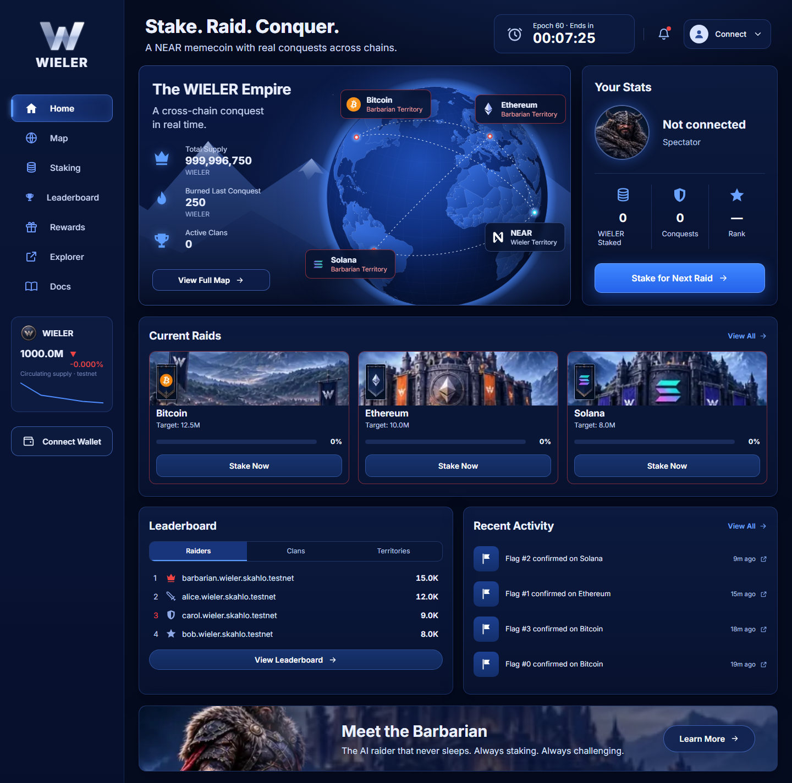
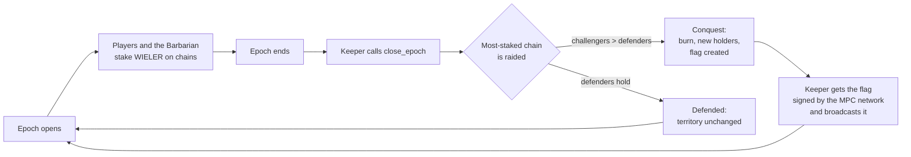
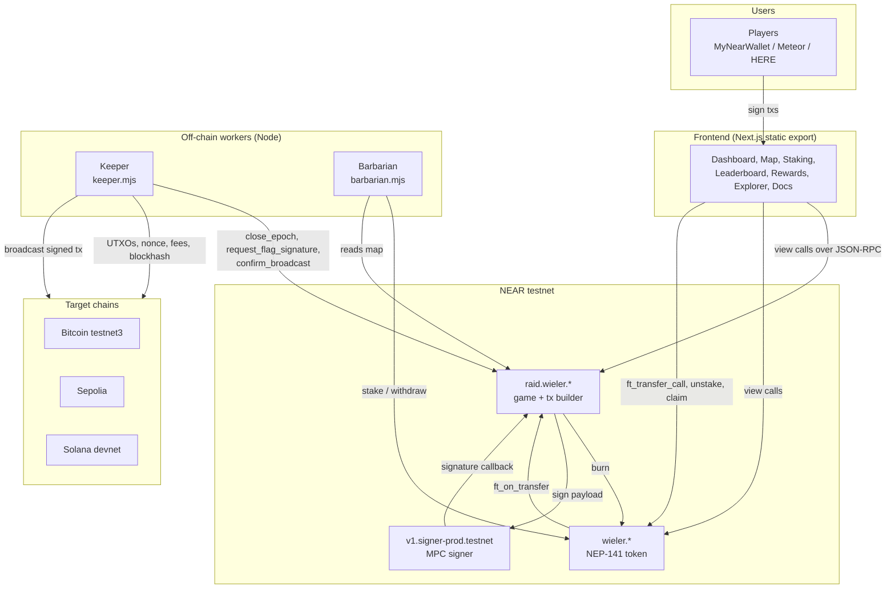
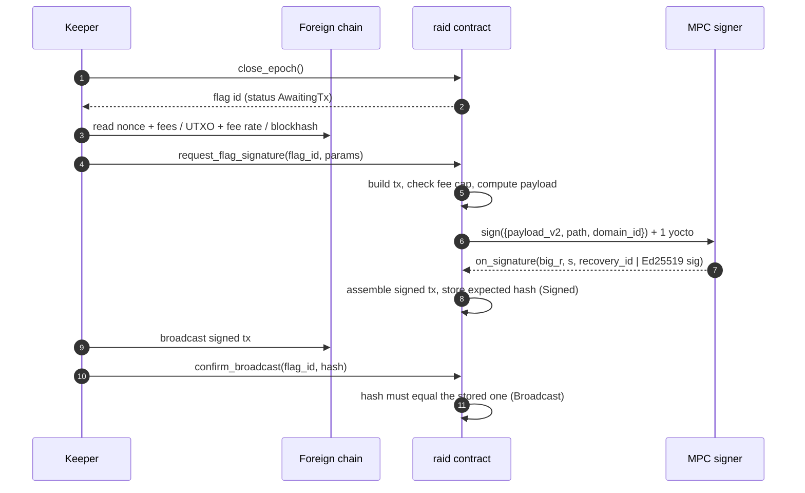

# WIELER: Stake. Raid. Conquer.

WIELER is a NEP-141 memecoin on NEAR whose game contract controls real wallets on Bitcoin, Ethereum
and Solana through **NEAR Chain Signatures**. Holders stake WIELER behind a chain to raid it. When a
raid wins, part of the stake is burned for good, and the NEAR MPC network signs a transaction on
the target chain that writes the winners' `.near` names into that chain's history. The contract
builds and checks every one of those transactions itself. An autonomous opponent, **the
Barbarian**, raids every epoch with its own war chest, so the map keeps changing even when no one
else plays.

There is no bridge, no wrapped asset and no custodian. The foreign wallets are derived from the raid
contract's account, and the MPC network only signs payloads the contract asks it to sign.



---

## Contents

- [Live testnet deployment](#live-testnet-deployment)
- [How the game works](#how-the-game-works)
- [Architecture](#architecture)
- [Smart contracts](#smart-contracts)
- [Cross-chain flags: Chain Signatures in detail](#cross-chain-flags-chain-signatures-in-detail)
- [Off-chain services](#off-chain-services)
- [Frontend](#frontend)
- [Repository layout](#repository-layout)
- [Development](#development)
- [Configuration reference](#configuration-reference)
- [Security model](#security-model)
- [Known limitations and PRD deviations](#known-limitations-and-prd-deviations)

---

## Live testnet deployment

| Component | Network | Address |
|---|---|---|
| WIELER token (NEP-141) | NEAR testnet | `wieler.skahlo.testnet` |
| Raid game contract | NEAR testnet | `raid.wieler.skahlo.testnet` |
| The Barbarian | NEAR testnet | `barbarian.wieler.skahlo.testnet` |
| Rewards pool | NEAR testnet | `pool.wieler.skahlo.testnet` |
| MPC signer | NEAR testnet | `v1.signer-prod.testnet` |
| Bitcoin wallet (P2WPKH, path `wieler/btc`) | Bitcoin testnet3 | `tb1q2m3crg9eacml4cfwstk2500w5sw3g3yrycy0vz` |
| Ethereum wallet (path `wieler/evm`) | Sepolia | `0xd4dcb0d441963ba4202888b975fa5ebf9eb2afe1` |
| Solana wallet (Ed25519, path `wieler/sol`) | Solana devnet | `BxFsmZLRpqiXhf8Tun851P7iFHrgSxCLhiZFXr72U7BF` |

Flags signed by the MPC network and confirmed on their chains:

| Flag | Chain | Transaction |
|---|---|---|
| #0 | Bitcoin testnet3 | [`a83c2ecd…0752`](https://blockstream.info/testnet/tx/a83c2ecd6a4bbef037b3d66b7a02d06f1fe8d031b0e6555a0f62c2246b610752) |
| #1 | Sepolia | [`0x1ca79a2c…2739`](https://sepolia.etherscan.io/tx/0x1ca79a2cdb21c5622aa7f96e05e88dc5476040e741e990fe43939b35a84e2739) |
| #2 | Solana devnet | [`5e9jq2fi…xiABh`](https://explorer.solana.com/tx/5e9jq2fi3zDPJ15smjQKKNuMqWGKFpJzQnSKTz6m4kj6X5oDYM8kUkTJHnPsWNcfkDfeN2qZcYoSTXHzZM5xiABh?cluster=devnet) |
| #3 | Bitcoin testnet3 | [`31d5db7f…caad`](https://blockstream.info/testnet/tx/31d5db7f28c43651e2899ce199e80e04518eed6fc4a24f793bb01d462c73caad) |

---

## How the game works

### The epoch loop



1. **Stake.** During an epoch (10 minutes on testnet), anyone can `ft_transfer_call` WIELER to the
   raid contract with the target chain in `msg`. Stakes are recorded per epoch and per chain.
2. **Resolve.** When the epoch ends, anyone can call `close_epoch` and earn the keeper tip. The
   chain with the most stake that epoch is the one raided. Stakers who already hold that territory
   count as defenders, everyone else as challengers.
3. **Conquer.** If the challengers out-stake the defenders (or the chain is unheld), the territory
   changes hands. A share of the winning stake is burned and a **flag** is created: a record of the
   conquest that must be engraved on the target chain.
4. **Engrave.** The keeper fetches live state from the foreign chain and asks the contract to sign
   the flag. The contract builds the transaction, the MPC network signs it, and the keeper broadcasts
   it and reports the hash back. The contract only accepts the exact hash it computed.
5. **Settle.** Stakes are pull-based: after an epoch closes, each staker calls `unstake` to withdraw
   their stake, minus the fee and any burn.

### Economics

| Parameter | Default | Meaning |
|---|---|---|
| Total supply | 1,000,000,000 WIELER | Minted once at `new`, never minted again |
| Allocation | 70% faucet / 20% rewards pool / 10% team | The faucet balance sits in the token contract itself |
| Faucet | 25,000 WIELER per account every 12 h | Testnet onboarding; registers storage automatically |
| First-conquest burn | 10% of the winning stake | `first_burn_bps = 1000` |
| Re-conquest burn | 5% of the winning stake | `reconquest_burn_bps = 500` |
| Raid fee | 2% of all stake in the epoch | Split: 1% to current holders, 0.5% to the chain's gas reserve, 0.5% to the keeper |
| Reclaim bounty | 10% of the Barbarian's winning stake | Held in escrow on the territory and paid to whoever takes it back |

Supply only ever goes down. Every burn calls the token contract's `burn`, emits a `Burned` event
and adds a point to the on-chain supply history that the frontend charts.

### The Barbarian

The Barbarian is a NEAR account with its own WIELER, run by [`scripts/barbarian.mjs`](scripts/barbarian.mjs).
Its strategy is published and deterministic, so anyone can check its moves:

- once per epoch it picks one chain it doesn't hold, preferring the **least-defended** one (ties go
  to the territory held longest, then to the name);
- it stakes `min(25% of its war chest, cap)`, where the contract enforces
  `cap = max(40% of the other raiders' stake this epoch, barbarian_floor)`;
- after each epoch it withdraws its closed stakes, so winnings return to the war chest.

Territories the Barbarian wins hold a reclaim bounty that pays players to take them back, which
gives everyone else a reason to keep fighting it.

### Clans and leaderboard

Raiders can `join_clan`. A territory records the dominant clan among its winners, and the
contract keeps per-raider and per-clan totals (stake, conquests, WIELER burned) that the
leaderboard reads directly.

---

## Architecture



**Design principles**

- **The chain is the database.** Stakes, territories, flags, the activity feed, supply history,
  raiders and clans all live in contract state and are exposed through view methods. The frontend
  has no backend and no indexer; it polls view calls every 10 seconds.
- **The contract builds the transaction itself.** Off-chain workers only supply facts about the
  foreign chain (a nonce, a UTXO, a blockhash). The raid contract serialises the transaction,
  computes the sighash, enforces the fee cap and value rules, and requests the signature. A
  compromised keeper can delay a flag but cannot make the MPC network sign anything else.
- **Permissionless upkeep.** `close_epoch`, `request_flag_signature` and `confirm_broadcast` can be
  called by anyone. The keeper is paid a tip, but anyone can run one.
- **Pull-based settlement.** Payouts are claimed by the stakers themselves, so `close_epoch` does a
  bounded amount of work however many stakers there are.

---

## Smart contracts

Both contracts are Rust, `near-sdk` 5.30, built with `cargo near` on the Rust 1.95 toolchain
(`contracts/rust-toolchain.toml`), with `overflow-checks` on in release builds.

### `wieler_token` ([contracts/token/src/lib.rs](contracts/token/src/lib.rs))

A standard NEP-141 / NEP-145 / NEP-148 token from `near-contract-standards`, plus:

| Method | Notes |
|---|---|
| `new(rewards_pool, team)` | Mints the fixed supply once: 70% to the contract (faucet), 20% to the pool, 10% to the team |
| `faucet()` | Payable; registers the caller's storage if needed, then sends 25,000 WIELER at most once every 12 h |
| `burn(amount, memo)` | 1 yoctoNEAR; burns from the caller's balance and emits the NEP-141 `ft_burn` event |
| `faucet_next_claim`, `total_burned`, `initial_supply` | Views |

### `wieler_raid` ([contracts/raid/src/lib.rs](contracts/raid/src/lib.rs))

| Group | Methods |
|---|---|
| Setup (owner) | `new`, `add_chain`, `set_config`, `register_barbarian`, `set_owner` |
| Playing | `ft_on_transfer` (stake), `unstake`, `claim_pending`, `claim_territory_rewards`, `join_clan` |
| Upkeep (anyone) | `close_epoch`, `request_flag_signature`, `confirm_broadcast` |
| Callbacks (private) | `on_signature`, `on_payout` |
| Views | `get_map`, `get_current_epoch`, `get_epoch`, `get_stakers`, `get_flags`, `get_flag`, `get_territories`, `get_raider(s)`, `get_clans`, `get_activity`, `get_supply_history`, `get_account_stakes`, `get_rewards`, `get_pending`, `get_total_burned`, `get_config`, `get_chains` |

**State model.** The current `Epoch` holds per-chain stake totals. Individual `StakeEntry`s are kept in
a `LookupMap` keyed by `(epoch, chain)`, with a per-account index for withdrawals. Each `Territory`
records its holders (up to `MAX_HOLDERS`), their winning stakes, the dominant clan, whether the
Barbarian holds it, and any reclaim-bounty escrow. `Flag`s are an append-only `Vector` that moves
through the states `AwaitingTx → Signing → Signed → Broadcast` (or `Failed`, which can be retried).

**Arithmetic.** Reward splits use a 256-bit `mul_div` (`primitive-types::U256`), so
`amount × stake / total` can't overflow `u128` at 18 decimals.

**Events.** NEP-297 events under the `wieler` standard: `Staked`, `EpochClosed`, `Conquered`,
`Defended`, `Burned`, `FlagSigned` and `FlagBroadcast`. The contract also keeps an activity log
that the frontend displays.

### Transaction builders ([contracts/raid/src/tx.rs](contracts/raid/src/tx.rs))

Built from scratch inside the contract, with no external chain SDKs:

| Chain | Transaction | Signing |
|---|---|---|
| Ethereum (EVM) | EIP-1559 type-2 self-send, value 0, memo as calldata, RLP-encoded | keccak256 → ECDSA (`domain_id 0`), `v` from the recovery id |
| Bitcoin | SegWit v0 spend of one P2WPKH UTXO → OP_RETURN(memo) + change back to the same address | BIP-143 sighash → ECDSA, DER-encoded with SIGHASH_ALL into the witness |
| Solana | Legacy message with one Memo-program instruction, fee payer = derived key | Raw message → EdDSA (`domain_id 1`) |

The memo has the form `WIELER E<epoch> <winner.near> …` (`WIELER BARB E<epoch> …` for the
Barbarian), cut to fit each chain's payload limit, which is at most 80 bytes (the OP_RETURN limit).

---

## Cross-chain flags: Chain Signatures in detail



- **Key derivation.** Each chain's key is `derived_public_key(path, predecessor = raid contract,
  domain_id)`. `add_chain` stores the derived public key and address, so the contract can rebuild
  the scriptPubKey and fee-payer fields itself.
- **Fee caps.** Every chain has a `max_fee` in its native unit. EVM checks
  `max_fee_per_gas × gas_limit ≤ max_fee` and Bitcoin checks the fee directly. The keeper can't
  drain a wallet through fees.
- **Value safety.** EVM flags are self-sends with value 0. Bitcoin flags return all change to the
  same derived address. Solana flags carry only a Memo instruction.
- **Staleness.** A flag that went stale before broadcast (a used nonce, a spent UTXO or an expired
  Solana blockhash) can be signed again with fresh parameters. The keeper detects this from the
  broadcast error and signs again automatically. For Solana it broadcasts as soon as the signature
  arrives, because a blockhash is only valid for about a minute.

---

## Off-chain services

All scripts are Node 20+ ES modules using `near-api-js` 5. Shared helpers live in
[`scripts/lib.mjs`](scripts/lib.mjs).

| Script | Role |
|---|---|
| [`deploy.mjs`](scripts/deploy.mjs) | Creates sub-accounts, deploys and initialises both contracts, derives the foreign keys and registers the chains, seeds the Barbarian, writes `frontend/src/config/deployment.json` and `scripts/.deployment.json` |
| [`keeper.mjs`](scripts/keeper.mjs) | Loop: closes ended epochs, prepares chain parameters, requests signatures, broadcasts, confirms, signs stale flags again |
| [`barbarian.mjs`](scripts/barbarian.mjs) | The Barbarian's published strategy (see above) |
| [`demo.mjs`](scripts/demo.mjs) | Scripted moves for the demo raiders (`epoch1`, `epoch2`, `status`, `unstake`) |
| [`set-chain.mjs`](scripts/set-chain.mjs) | Owner tool: registers a chain again with changed fields (explorer URL, fee cap), keeping its reserve and count |
| [`topup.mjs`](scripts/topup.mjs) | Sends NEAR for gas to the demo accounts and the Barbarian |

Signer keys come from the near-cli keychain (`~/.near-credentials`) or, on servers, from the
`NEAR_SIGNER_KEYS` environment variable (`account=ed25519:…` pairs). Foreign chains are read from
Blockstream (Bitcoin testnet3), a public Sepolia RPC and the Solana devnet RPC.

---

## Frontend

Next.js 14 (App Router) built as a **static export**: plain HTML, JS and images that any static
host can serve.

| Area | Implementation |
|---|---|
| Wallets | `@near-wallet-selector` 8.9 with MyNearWallet, Meteor and HERE |
| Data | [`src/lib/providers.tsx`](frontend/src/lib/providers.tsx): one `DataProvider` polls view methods every 10 s and keeps the clock in step with chain time for the epoch countdown |
| Globe | [`src/components/Globe.tsx`](frontend/src/components/Globe.tsx): d3-geo orthographic projection of world-atlas 110m countries, territory markers and raid arcs, labels kept inside the panel |
| Foreign balances | [`src/lib/foreign.ts`](frontend/src/lib/foreign.ts) reads each derived wallet's balance on its own chain |
| Pages | Home, Map, Staking, Leaderboard, Rewards, Explorer (epochs, burns, flags with explorer links), Docs |
| Art | Cropped from one asset sheet by [`tools/crop-assets.py`](frontend/tools/crop-assets.py) into `public/images/art/` |

Contract IDs and RPC endpoints come from [`src/config/deployment.json`](frontend/src/config/deployment.json),
which the deploy script writes, so the build needs no environment variables.

---

## Repository layout

```
contracts/
  Cargo.toml              workspace (token, raid), size-optimised release profile
  rust-toolchain.toml     Rust 1.95 + wasm32-unknown-unknown
  build.sh                cargo near build → contracts/res/*.wasm
  token/src/lib.rs        NEP-141 token, faucet, burn
  raid/src/lib.rs         game state machine, Chain Signatures integration
  raid/src/tx.rs          RLP/EIP-1559, BIP-143/P2WPKH/bech32, Solana message builders
  raid/src/tests.rs       unit tests for the game loop
  res/                    built wasm artifacts
frontend/
  src/app/                routes: /, map, staking, leaderboard, rewards, explorer, docs
  src/components/         Shell, Globe, home sections, UI primitives, icons
  src/lib/                RPC client, wallet and data providers, game helpers, foreign-chain reads
  src/config/             deployment.json (generated)
  public/images/art/      cropped game art
  tools/                  asset sheet and crop script
scripts/                  deploy, keeper, Barbarian, demo and owner tools (Node)
deploy/aws/               systemd units for running the keeper and the Barbarian on a server
docs/                     screenshots
```

---

## Development

### Prerequisites

- Rust via `rustup` and `cargo-near` (under WSL or Linux on Windows)
- Node.js 20 or newer
- A funded NEAR testnet account in the near-cli legacy keychain

### Contracts

```bash
cd contracts
cargo test          # 9 tests: tx builders and full game cycles
./build.sh          # → contracts/res/wieler_token.wasm, wieler_raid.wasm
```

The tests cover conquest and re-conquest, defence, the Barbarian's caps and reclaim bounty,
payload limits, late-stake refunds and deterministic EVM signed-transaction hashes.

### Deploying to NEAR testnet

```bash
cp scripts/.env.example scripts/.env     # set MASTER_ACCOUNT
cd scripts && npm install
node deploy.mjs                          # ~8 NEAR; prints the derived foreign wallets
```

Fund the printed wallets from testnet faucets (Bitcoin testnet3, Sepolia ETH, Solana devnet SOL)
so their flags can be broadcast.

### Running locally

```bash
cd scripts
node keeper.mjs          # epochs, signatures, broadcasts
node barbarian.mjs       # the Barbarian
node demo.mjs epoch1     # demo raiders take their first territories
cd ../frontend && npm install && npm run dev
```

`npm run build` in `frontend/` produces the static site in `frontend/out/`.

---

## Configuration reference

`scripts/.env` (see [`.env.example`](scripts/.env.example)):

| Variable | Default | Purpose |
|---|---|---|
| `MASTER_ACCOUNT` | none (required) | Parent account for the deployment |
| `EPOCH_MS` | `600000` | Epoch length used at deploy time |
| `NEAR_NODE_URL` | `https://test.rpc.fastnear.com` | NEAR RPC |
| `NEAR_SIGNER_KEYS` | none | `account=ed25519:…` pairs when there is no keychain |
| `KEEPER_ACCOUNT` | `MASTER_ACCOUNT` | Account the keeper signs with |
| `MPC_CONTRACT` | `v1.signer-prod.testnet` | Chain Signatures signer |
| `SEPOLIA_RPC` | publicnode Sepolia | EVM reads and broadcast |
| `SOLANA_RPC` | `https://api.devnet.solana.com` | Solana reads and broadcast |
| `BTC_API` | `https://blockstream.info/testnet/api` | Esplora API for Bitcoin testnet3 |
| `BARBARIAN_FLOOR`, `BARBARIAN_SEED` | `5000`, `5000000` | Barbarian stake floor and starting war chest |
| `KEEPER_INTERVAL_MS`, `BARBARIAN_INTERVAL_MS` | `15000`, `20000` | Loop intervals |

On-chain parameters (burn rates, fee split, Barbarian caps, bounty) are in the raid contract's
`Config` and can be changed by the owner with `set_config`.

---

## Security model

| Actor | Trusted for | Cannot |
|---|---|---|
| Raid contract | Game rules, transaction construction, fee caps | n/a; it is the root of trust |
| MPC network | Signing payloads the contract asks it to sign | Sign without a request from the contract's account |
| Keeper | Liveness: closing epochs, delivering foreign-chain facts, broadcasting | Change a transaction's recipient, value or memo; exceed the fee cap; confirm a hash other than the signed one |
| Barbarian | Playing by its published strategy | Stake above the contract-enforced cap |
| Owner | Registering chains, tuning `Config`, registering the Barbarian | Move player stakes |

Bad inputs from a keeper (a fake UTXO or a wrong nonce) produce a transaction that fails on the
foreign chain. It loses nothing, and the flag can be signed again.

---

## Known limitations and PRD deviations

- The Barbarian runs as a normal process with its account key (the PRD's documented fallback),
  not yet as a Shade Agent in a TEE with a published attestation.
- Signing is requested after `close_epoch` rather than inside it, because the transaction needs
  live foreign-chain state (nonce, UTXO, blockhash). The contract still builds and checks every
  transaction.
- Exactly one chain is raided per epoch: the one with the most stake.
- The sidebar "price" card shows circulating supply, since testnet WIELER has no market.
- Bitcoin uses testnet3 through Blockstream's Esplora API, because mempool.space's testnet4
  endpoints weren't reachable from the development network.
- The frontend polls instead of subscribing to events, so it can lag by up to 10 seconds.
